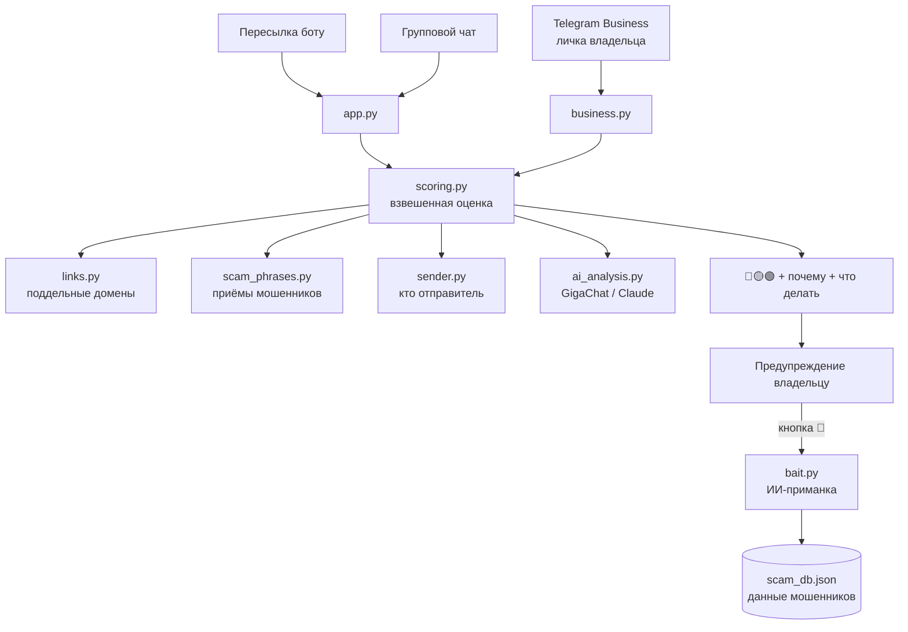

# 🛡 ИИ-антифрод для Telegram

**Охранник в личке.** Бот подключается к личному аккаунту через Telegram Business, в фоне читает входящие
переписки и предупреждает владельца, когда ему пишет мошенник: показывает уровень риска, объясняет,
на чём основана оценка, и подсказывает, что делать. По кнопке владельца бот сам ведёт диалог
с мошенником от его имени — вежливо тянет время и выпрашивает его данные.

> Проект команды на хакатоне **ВайбХак ФКН**, тема 2 — «Интернет больше не доказательство».

---

## 😟 Проблема

Схемы обмана в мессенджерах разворачиваются за несколько сообщений:

> «Здравствуйте, это служба безопасности банка» → «по вашей карте подозрительная операция» → «продиктуйте код из СМС»

Каждое сообщение по отдельности выглядит безобидно, а человек понимает, что это был мошенник, слишком поздно.
Чтобы проверить сообщение в обычной нейросети, нужно **самому заподозрить** обман — но жертва как раз ничего не подозревает.

## 💡 Решение

| | Обычная LLM | Наш бот |
|---|---|---|
| Когда проверяет | когда человек сам спросит | **всегда, в фоне** |
| Что анализирует | одно сообщение | **весь разговор** |
| На чём основан вывод | одна модель | **4 независимых сигнала** + ИИ |
| Если ИИ недоступен | не работает | работает на правилах |
| Результат | «скорее мошенничество» | **уровень риска 🔴🟡🟢 + почему + что делать** |
| Ответ мошеннику | — | **приманка**: тянет время и собирает его данные |
| Кто принимает решение | — | **всегда человек** (кнопки 🎣 / ⏹) |

---

## ✨ Возможности

### 🛡 Защита лички в фоне (Telegram Business)
- проверяет каждое входящее сообщение и **весь диалог** (последние 10 сообщений);
- проверяет и **отредактированные** сообщения (трюк «отправил безобидное, потом заменил на ссылку»);
- предупреждает владельца **без спама**: только когда угроза выросла 🟢 → 🟡 → 🔴.

### 🎣 ИИ-приманка (по кнопке владельца)
- отвечает мошеннику **от имени владельца**, в роли персонажа его пола и возраста (8 персонажей);
- вежливо тянет время по этапам: знакомство → «почти сделал» → «не уходите, сын скоро подойдёт»;
- **целенаправленно выпрашивает** организацию, имя, телефон, карту, ссылку — и показывает владельцу, что собрано;
- ведёт себя как человек: «прочитано» → пауза → «печатает…» → ответ; на пачку сообщений отвечает один раз,
  на повторы не отвечает, замолчавшему мошеннику пишет сам «Вы тут?»;
- старшие персонажи «не понимают» крипту, NFT, ботов и QR-коды; на любое чужое имя отвечают «это не я»;
- если мошенник **грубит или угрожает** — бот сам выходит из разговора и передаёт его владельцу с советом.

### 📩 Без Premium
- **пересылка**: перешлите боту сообщение или скриншот — получите отчёт;
- **групповые чаты**: бот молчит и отвечает только на скам.

### 📊 Меню
Подключение защиты, статистика, пойманные данные, профиль, справка — кнопками и командами
`/menu` `/stats` `/caught` `/profile` `/help`.

---

## 🧭 Как это выглядит

```
⚠️ Сообщение от Служба Безопасности:
«Здравствуйте, это служба безопасности Сбербанка, продиктуйте код из СМС»

🔴 Похоже на мошенничество
Уверенность проверки: 80%

💬 Приёмы мошенников
Код из СМС: просят код — так угоняют Telegram, Госуслуги и банк;
Официальные лица: мошенники часто представляются банком или госорганами

✅ Что делать
• Не переходи по ссылкам и никому не называй коды из СМС
• Если пишет «знакомый» — позвони ему по телефону, а не в Telegram
• Пожалуйся на сообщение: ⋮ → Пожаловаться

[🎣 Пусть бот ведёт диалог]  [🙅 Не надо]
```

---

## 🏗 Архитектура



### Как считается риск
1. **Четыре проверки** выдают вердикт (мошенничество / подозрительно / неясно / безопасно) и уверенность 0–1.
2. **Взвешенное среднее**: `опасность = Σ(опасность × уверенность) / Σ(уверенность)` — уверенная проверка весит больше.
3. **Железная улика**: если хоть одна проверка уверенно (≥ 0.6) видит мошенничество, итог не ниже 🔴.
4. **Цвет**: ≥ 0.65 — 🔴, 0.3–0.65 — 🟡, ниже — 🟢.

| Сообщение | Итог |
|---|---|
| «Проголосуй за племянницу `telegrarn-vote.top`» | 🔴 подменённый домен + схема «голосование» |
| «Зайдите на gosuslugi.ru и продиктуйте код» | 🔴 официальный сайт не перевешивает просьбу кода |
| «Заработок от 5000 в день без опыта» | 🟡 подозрительно, но не доказано |
| «Скинь 500 за пиццу», «вот лекция на YouTube» | 🟢 без ложных тревог |

---

## 🚀 Запуск

**Требования:** Python 3.11+, macOS / Linux / Windows.

```bash
git clone https://github.com/gunya98/vibehackezhe.git
cd vibehackezhe
python3 -m venv .venv && source .venv/bin/activate
pip install -r requirements.txt
cp .env.example .env          # впишите токен бота (и, по желанию, ключ ИИ)
python app.py
```

### Настройка `.env`

| Переменная | Обязательно | Что это |
|---|---|---|
| `TELEGRAM_TOKEN` | ✅ | токен бота от [@BotFather](https://t.me/BotFather) |
| `GIGACHAT_CREDENTIALS` | — | Authorization Key GigaChat API (есть бесплатный тариф для физлиц) |
| `GIGACHAT_MODEL` | — | модель GigaChat, по умолчанию `GigaChat-2` |
| `ANTHROPIC_API_KEY` | — | ключ Claude API (если нет GigaChat) |

Без ключей ИИ бот полностью работает на правилах и заготовках. Проверить ИИ: `python check_ai.py`.

### Подключение к личному аккаунту (Telegram Business)
1. [@BotFather](https://t.me/BotFather) → ваш бот → **Bot Settings → Business Mode** (может называться Secretary Mode) → включить.
2. На аккаунте с **Telegram Premium**: **Настройки → Telegram для бизнеса → Чат-боты** → имя бота →
   доступ ко **всем чатам** → разрешить **читать и отвечать на сообщения**.
3. Бот пришлёт «🛡 Защита включена» и спросит пол и возраст владельца (для персонажа приманки).

### Проверка без Telegram
```bash
python simulate_business.py   # полный сценарий мошенника на имитации Telegram (без токена и Premium)
python test_local.py          # оценка риска на примерах (с флагом --ai — с GigaChat/Claude)
```

---

## 📁 Структура

```
├── app.py                 # запуск, /start, пересылка, группы
├── business.py            # Telegram Business: проверка лички, предупреждения, приманка, задержки
├── menu.py                # меню, статистика, пойманные данные
├── profiles.py            # пол и возраст владельца → персонаж приманки
├── scoring.py             # сигналы → 🔴🟡🟢 + советы
├── ui.py                  # оформление отчёта
├── checks/
│   ├── links.py           # поддельные домены
│   ├── scam_phrases.py    # приёмы мошенников
│   ├── sender.py          # кто отправитель
│   ├── ai_analysis.py     # ИИ-анализ диалога
│   ├── llm.py             # GigaChat / Claude, распознавание отказов модели
│   ├── bait.py            # промпты и логика приманки, сбор данных мошенника
│   ├── bait_phrases.py    # заготовки для работы без ИИ
│   └── rudeness.py        # мат, оскорбления, угрозы
├── docs/BAIT.md           # подробно: как приманка общается, персонажи по возрастам
├── simulate_business.py   # имитация Telegram для тестов
├── test_local.py          # тест оценки риска
└── check_ai.py            # проверка подключения ИИ
```

---

## 🤖 Как мы использовали ИИ

**В разработке**
- **Claude (проект claude.ai)** — «техлид»: брейншторм и выбор идеи, архитектура, генерация модулей, ревью, отладка.
- **Общая память агентов** — весь контекст хакатона (задание, критерии, роли, журнал решений) в [`CLAUDE.md`](CLAUDE.md);
  Claude Code у каждого участника подхватывает его автоматически.
- **Проверка перед каждым пушем** — имитация сценария мошенника (`simulate_business.py`) и набор примеров (`test_local.py`).

**В продукте**
- **GigaChat** анализирует диалог и объясняет оценку, а в режиме приманки играет владельца аккаунта.
- Модель не дообучалась — **промпт-инжиниринг**: системный промпт с персонажем, правила стиля по возрасту,
  few-shot примеры по теме сообщения, этапы разговора, пост-обработка ответа. Подробно — в [`docs/BAIT.md`](docs/BAIT.md).
- **Устойчивость**: отказы модели («чувствительные темы») распознаются и подменяются заготовками; без ИИ бот
  работает на правилах.

---

## ⚖️ Этика и ограничения

- **Решение всегда за человеком**: приманка включается и выключается только кнопкой владельца;
  при грубости или угрозах бот сам возвращает разговор человеку.
- **Никакой деанонимизации**: бот сохраняет только то, что мошенник сам написал в чате (карты, телефоны, ссылки,
  названные имя и организацию). Сбор IP, геолокации и т. п. сознательно не делаем.
- **Данные локальны**: `scam_db.json` и `profiles.json` хранятся на устройстве, где запущен бот, и не попадают в git.
- Бот видит переписку только с момента подключения и только в выбранных чатах; работает, пока запущен `app.py`.
- Голосовые сообщения пока не анализируются; GigaChat не анализирует картинки (Claude — анализирует).
- Веса проверок подобраны экспертно и проверены на наборе примеров — это подсказка, а не приговор.

## 🔭 Что дальше

- **Общая база индикаторов**: «эта карта уже встречалась в 5 мошеннических диалогах» + выгрузка в банки.
- **Своя ML-модель** (TF-IDF + логистическая регрессия) как быстрый первый фильтр перед LLM, обучение весов
  на диалогах, собранных приманкой.
- Расшифровка голосовых сообщений и анализ скриншотов через GigaChat.
- Работа на сервере 24/7 и хранение истории диалогов между перезапусками.

---

## 👥 Команда

| Участник | Роль |
|---|---|
| _имя_ | Проверки и оценка риска (`checks/`, `scoring.py`) |
| _имя_ | Бот и Telegram Business (`app.py`, `business.py`, `menu.py`) |
| _имя_ | ИИ и промпты (GigaChat, персонажи приманки) |
| _имя_ | Продукт и защита (примеры, сценарий демо, презентация) |
